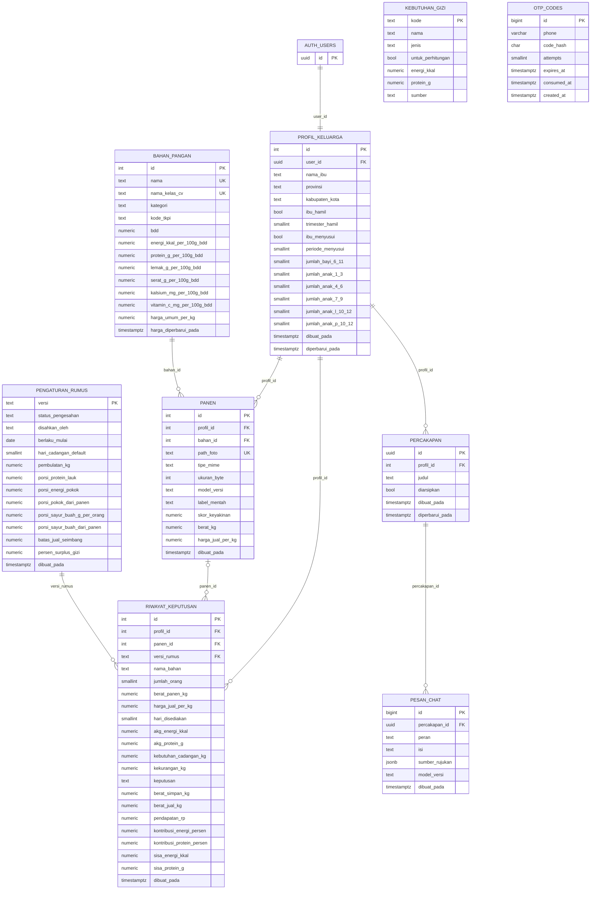

# Panduan Inisialisasi Database PANGANITA (Supabase PostgreSQL)

Dokumentasi ini menjelaskan langkah-langkah menyiapkan struktur database, keamanan Row Level Security (RLS), dan seed data awal platform **PANGANITA** dari nol.

---

## 1. File Database Tersedia

| File | Deskripsi |
|---|---|
| [`schema.sql`](./schema.sql) | DDL seluruh tabel (`profil_keluarga`, `kebutuhan_gizi`, `bahan_pangan`, `pengaturan_rumus`, `panen`, `riwayat_keputusan`, `otp_codes`, `percakapan`, `pesan_chat`), Index, kebijakan RLS, dan Storage Bucket `hasil-panen`. |
| [`seed.sql`](./seed.sql) | Data awal standar AKG Permenkes No. 28/2019, master bahan pangan pekarangan (Lele, Nila, Telur, Bayam, Kangkung, Ubi, dll), dan parameter rumus kalkulasi panen. |

---

## 2. Langkah Eksekusi di Supabase

1. Buka dashboard proyek **Supabase** Anda.
2. Masuk ke menu **SQL Editor** pada navigasi sisi kiri.
3. Klik tombol **New Query**.
4. Salin seluruh isi file [`database/schema.sql`](./schema.sql), tempelkan di SQL Editor, lalu klik **Run**. Pastikan status query menampilkan `Success`.
5. Buka tab query baru, salin seluruh isi file [`database/seed.sql`](./seed.sql), tempelkan di SQL Editor, lalu klik **Run**.

---

## 3. Cakupan Tabel & Relasi Utama

---

## 4. Keamanan & Row Level Security (RLS)

- **Semua tabel dilindungi RLS aktif**: Data pribadi (`profil_keluarga`), catatan panen, riwayat keputusan, dan percakapan chat Bu Nita AI terisolasi per `auth.uid()`.
- **Tabel Publik Read-Only**: `kebutuhan_gizi` dan `bahan_pangan` dapat dibaca secara publik oleh aplikasi tanpa risiko penulisan ilegal.
- **Tabel Autentikasi `otp_codes`**: Dilindungi RLS tanpa eksposur ke klien Supabase publik; interaksi dilakukan eksklusif via direct PostgreSQL connection di Route Handler.
- **Supabase Storage Bucket `hasil-panen`**: File foto hanya dapat diunggah, dibaca, dan dihapus oleh pemiliknya masing-masing pada path `/{user_id}/{nama_file}`.

