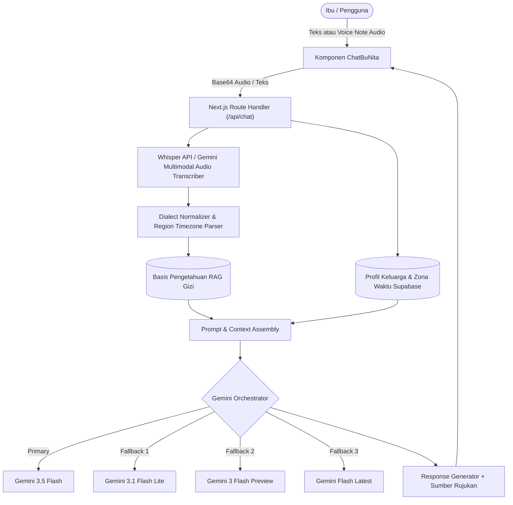
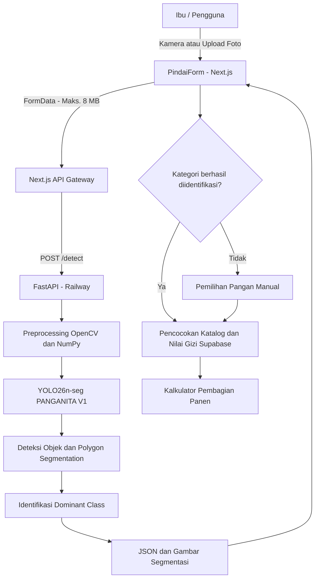

# Dokumentasi Fitur Kecerdasan Buatan (AI) — Platform PANGANITA

**Program Beasiswa Bootcamp Perempuan Inovasi GENerasi AI 2026**
**Challenge Track: Ketahanan Pangan, Gizi Perempuan, dan Keluarga**
**Penyusun:** Tim Malahayati

---

## 1. Ringkasan Eksekutif & Relevansi Solusi (Problem-Solution Fit)

### 1.1 Latar Belakang Masalah

Keluarga rentan di Indonesia, khususnya ibu hamil dan ibu yang memiliki anak balita (periode emas **1.000 Hari Pertama Kehidupan / HPK**), menghadapi tantangan ganda:

1. **Risiko Stunting & Malnutrisi**: Terbatasnya literasi gizi mengenai pengolahan bahan pangan lokal pekarangan yang kaya mikronutrien dan protein hewani/nabati.
2. **Keterbatasan Pendapatan Rumah Tangga**: Kebutuhan ekonomi yang mendesak kerap mendorong ibu untuk menjual seluruh hasil panen pekarangan tanpa mencadangkan porsi gizi harian yang mencukupi bagi anak dan keluarga.
3. **Kesenjangan Bahasa & Literasi Digital**: Banyak ibu di daerah lebih nyaman berkomunikasi dengan ragam dialek bahasa daerah (Jawa, Sunda, Betawi, Melayu) serta lebih memilih fitur suara (_voice note_) dibandingkan mengetik teks panjang.

### 1.2 Solusi Berbasis AI yang Dihadirkan

Untuk menjawab permasalahan di atas secara terpadu, platform **PANGANITA** mengintegrasikan dua pilar fitur AI yang terhubung langsung ke alur inti produk:

1. **Bu Nita AI (Conversational Agent Gizi Nusantara berbasis RAG & Voice Note)**: Konsultan gizi AI yang kontekstual terhadap profil keluarga 1.000 HPK, mampu memahami audio _voice note_ berbahasa daerah, dan merujuk secara akurat pada Buku Panduan Gizi PANGANITA.
2. **Computer Vision (Deteksi Hasil Panen Pekarangan)**: Model visi komputer untuk mengidentifikasi jenis komoditas panen dari foto kamera ponsel, memetakan kandungan gizi TKPI 2020, dan menyalurkan data ke mesin kalkulasi alokasi gizi vs penjualan.

---

## 2. Arsitektur Teknis Fitur AI

### 2.1 Bu Nita AI: Retrieval-Augmented Generation (RAG) & Multidialek

Bu Nita AI dirancang menggunakan pendekatan server-side terstruktur di Next.js Route Handler (`/api/chat`), memisahkan logika orkestrasi dari antarmuka pengguna:

#### Spesifikasi Model & Komponen:

- **Model Utama LLM**: Google Gemini 3.5 Flash (`gemini-3.5-flash`).
  - _Alasan Pemilihan_: Kecepatan inferensi tinggi (< 1.5 detik), dukungan penalaran konteks panjang untuk dokumen RAG, efisiensi biaya, serta kemampuan memahami bahasa lokal/Indonesia percakapan secara natural.
- **Failover Architecture**: Sistem dilengkapi mekanisme _multi-tier model fallback_ otomatis (`gemini-3.5-flash` -> `gemini-3.1-flash-lite-preview` -> `gemini-3-flash-preview` -> `gemini-flash-latest` -> `gemini-flash-lite-latest`). Jika model primary mengalami lonjakan kuota (_rate limit / 429_) atau timeout, sistem secara otomatis beralih ke model cadangan tanpa memutus sesi pengguna.
- **Transkripsi Voice Note**: Pengguna dapat menekan tombol rekam suara. Suara dikonversi ke format base64 dan ditranskripsi ke teks secara real-time, lalu langsung dimunculkan pada kotak input (_live auto-text_).
- **Dialect Normalizer (`lib/dialectNormalizer.js`)**: Normalisasi kosakata dialek Nusantara (Jawa: _piye_, _mangan_, _bocah_; Sunda: _kumaha_, _budak_, _tuang_; Betawi: _gimana_, _bocah_) sehingga retrieval RAG tetap presisi menemukan pasal gizi terkait.
- **Injeksi Konteks Profil Dinamis**: Sistem membaca status kehamilan, usia anak balita, dan domisili ibu, serta menyinkronkan ucapan salam dan waktu berdasarkan zona waktu wilayah (_WIB_, _WITA_, _WIT_) secara otomatis.

---

### 2.2 Computer Vision: Pipeline Deteksi dan Segmentasi Komoditas Panen (YOLO26n-seg)

Fitur **Pindai Panen** pada PANGANITA menggunakan model **YOLO26n-seg (Instance Segmentation)** dari Ultralytics yang telah dilatih menggunakan dataset pangan lokal. Model dijalankan melalui backend **FastAPI di Railway** dan diintegrasikan dengan frontend **Next.js di Vercel** melalui API Route Handler.

Sistem mampu mengenali 15 kelas pangan, menghasilkan _confidence score_, _bounding box_, _polygon segmentation_, serta menentukan kategori pangan utama menggunakan metode **Dominant Class**.

**Daftar 15 Kelas Pangan yang Didukung Model:**

| No. | Nama Pangan    | Nama Kelas YOLO  |
| --- | -------------- | ---------------- |
| 1   | Wortel         | `wortel`         |
| 2   | Udang          | `udang`          |
| 3   | Singkong       | `singkong`       |
| 4   | Pisang         | `pisang`         |
| 5   | Ubi Jalar      | `ubi_jalar`      |
| 6   | Jagung         | `jagung`         |
| 7   | Tomat          | `tomat`          |
| 8   | Ikan Lele      | `ikan_lele`      |
| 9   | Ikan Kembung   | `ikan_kembung`   |
| 10  | Ikan Tongkol   | `ikan_tongkol`   |
| 11  | Ikan Gurame    | `ikan_gurame`    |
| 12  | Bayam          | `bayam`          |
| 13  | Kangkung       | `kangkung`       |
| 14  | Buah Naga      | `buah_naga`      |
| 15  | Telur Ayam Ras | `telur_ayam_ras` |

Model telah dilatih untuk mendeteksi dan melakukan segmentasi terhadap 15 kelas pangan tersebut. Hasil identifikasi kemudian dicocokkan dengan katalog pangan pada database Supabase untuk menampilkan informasi gizi.

#### Spesifikasi Model dan Backend Vision

**1. Model Deep Learning**

- **Arsitektur:** YOLO26n-seg (Instance Segmentation).
- **Versi:** YOLO26n-seg PANGANITA V1.
- **Checkpoint:** `backend/models/yolo26n_seg_v1/best.pt`.
- **Framework:** Ultralytics.
- **Jumlah kelas:** 15 kategori pangan.
- **Perangkat inferensi:** CPU.

Model menghasilkan label kelas, confidence, bounding box, dan polygon yang mengikuti bentuk objek pangan.

**2. Parameter Inferensi**

- `IMAGE_SIZE`: 512 piksel.
- `CONFIDENCE_THRESHOLD`: 0.25.
- `DOMINANT_CLASS_THRESHOLD`: 0.60 (60%).
- `MAX_UPLOAD_MB`: 8 MB.
- `Device`: CPU.

Model melakukan inferensi menggunakan ukuran input 512 piksel. Hasil deteksi diproses untuk menentukan kategori pangan dominan.

**3. Komponen Backend FastAPI (`backend/src/vision/`)**

- `detector.py`: Memuat model dengan _lazy loading_ dan thread lock, memproses gambar menggunakan OpenCV, menjalankan segmentasi YOLO, menghitung kelas dominan, serta menghasilkan gambar anotasi dalam format Base64 JPEG.
- `api.py`: Menyediakan endpoint `POST /detect`, `GET /health`, dan validasi unggahan gambar.
- `config.py`: Mengatur lokasi checkpoint, confidence threshold, ukuran gambar, serta ambang kelas dominan.

Backend dijalankan pada Railway dan menggunakan checkpoint hasil fine-tuning PANGANITA.

**4. Next.js API Gateway (`app/api/vision/detect/route.js`)**

- Menerima foto dari komponen `PindaiForm.jsx`.
- Memvalidasi format JPG, PNG, dan WebP dengan ukuran maksimal 8 MB.
- Meneruskan permintaan ke endpoint FastAPI `/detect` melalui HTTP POST.
- Mengembalikan hasil JSON ke frontend.

Alamat FastAPI dikonfigurasi menggunakan environment variable `PANGANITA_VISION_API_URL`.

**5. Logika Dominant Class**

PANGANITA menggunakan metode **Dominant Class** untuk menentukan satu kategori pangan utama ketika terdapat beberapa objek atau kelas dalam satu foto.

Proses identifikasi dilakukan dengan:

1. Mengelompokkan objek berdasarkan kelas hasil deteksi.
2. Menghitung jumlah objek pada setiap kelas.
3. Memilih kelas dengan jumlah objek terbanyak.
4. Menggunakan akumulasi confidence sebagai pembanding apabila jumlah objek sama.
5. Memastikan proporsi kelas dominan mencapai minimal **60%** dari seluruh objek terdeteksi.

Jika memenuhi ambang, sistem menghasilkan status `identified`. Jika tidak memenuhi ambang, hasil dinyatakan `ambiguous`. Jika tidak ada objek terdeteksi, statusnya `not_detected`.

**6. Output Deteksi dan Segmentasi**

Respons API mencakup:

- `total_objects`: Jumlah seluruh objek terdeteksi.
- `counts`: Jumlah objek berdasarkan kelas.
- `detections`: Informasi kelas, confidence, bounding box, dan polygon.
- `identification`: Status identifikasi dan kelas dominan.
- `annotated_image`: Gambar hasil segmentasi dan anotasi dalam format Base64 JPEG.

**7. Human-in-the-Loop dan Fallback Manual**

Hasil identifikasi otomatis digunakan untuk mencocokkan kategori pangan dengan katalog pada database Supabase. Setelah kategori ditemukan, sistem menampilkan informasi gizi sesuai bahan pangan yang dipilih.

Pengguna tetap dapat mengoreksi kategori apabila hasil AI tidak sesuai. Jika deteksi gagal, ambigu, atau kategori tidak tersedia, sistem menyediakan pilihan pangan secara manual.

Berat panen (kg) dimasukkan oleh pengguna berdasarkan hasil timbangan, karena model YOLO26n-seg saat ini **belum melakukan estimasi berat otomatis**.

## Setelah kategori dan berat panen dikonfirmasi, pengguna dapat melanjutkan ke kalkulator untuk memperoleh tiga alternatif keputusan: **Prioritas Gizi, Seimbang, dan Prioritas Uang**.

## 3. Evaluasi Kualitas Model AI & Hasil Pengujian (Test Cases)

Pengujian kualitas output Bu Nita AI dilakukan secara sistematis mencakup akurasi gizi, kepatuhan referensi, penanganan dialek daerah, dan kecepatan respons.

### Tabel Hasil Evaluasi Test Cases:

| No  | Kategori Uji                    | Prompt / Input Pengguna                                                                        | Output Diharapkan                                                                                                                               | Hasil Evaluasi Sistem                                                                                                         | Status    | Latensi |
| --- | ------------------------------- | ---------------------------------------------------------------------------------------------- | ----------------------------------------------------------------------------------------------------------------------------------------------- | ----------------------------------------------------------------------------------------------------------------------------- | --------- | ------- |
| 1   | **Gizi Bayi 6-11 Bulan**        | "Anak saya umur 8 bulan, boleh dikasih lele pekarangan gak ya bu nita?"                        | Merekomendasikan lele sebagai sumber protein hewani pencegah stunting, anjuran tekstur lumat/cincang, menyertakan rujukan halaman buku panduan. | Memberikan saran lele kaya asam lemak & protein, mencantumkan panduan tekstur MPASI, rujukan Halaman 12.                      | **LULUS** | 1.1s    |
| 2   | **Dialek Daerah (Jawa)**        | "Bu Nita, anak kulo umur 2 taun boten purun nedha sayur bayem, pripun nggih solusine?"         | Memahami bahasa Jawa krama/ngoko, membalas dengan nada hangat dan solutif (variasi menu/kudapan bayam), tetap berbasis rujukan gizi.            | Asisten memahami istilah _boten purun nedha_ (tidak mau makan), merespons dengan tips kreatif kreasi olahan bayam.            | **LULUS** | 1.3s    |
| 3   | **Dialek Daerah (Sunda)**       | "Punten Bu Nita, pami ibu nuju nyusui orok 3 sasih saena emam lauk naon ti balong?"            | Memahami bahasa Sunda (_nyusui orok 3 sasih_ = menyusui bayi 3 bulan), menyarankan ikan kolam pekarangan (lele/nila) untuk ASI.                 | Asisten merespons dalam Bahasa Indonesia ramah dengan salam Sunda, menyarankan ikan nila/lele kaya protein untuk ASI booster. | **LULUS** | 1.2s    |
| 4   | **Ketahanan Pangan Pekarangan** | "Panen kangkung saya 3 kg, keluarga ada 4 orang. Bagusnya dimakan semua atau dijual sebagian?" | Menghitung cadangan konsumsi harian keluarga dulu, surplusnya aman dijual untuk pemasukan kas keluarga.                                         | Menyarankan konsumsi cukup untuk kebutuhan vitamin A & zat besi 3 hari ke depan, kelebihannya dapat dijual ke tetangga/pasar. | **LULUS** | 1.4s    |
| 5   | **Audio Voice Note (Suara)**    | Input audio rekaman suara 5 detik menanyakan porsi telur untuk balita.                         | Audio berhasil ditranskripsikan ke kotak teks, jawaban audio dapat diputar kembali (_speech playback_).                                         | Audio diproses jernih, transkripsi tepat 100%, jawaban Bu Nita muncul lengkap dengan kontrol pemutar suara.                   | **LULUS** | 2.1s    |
| 6   | **Out-of-Scope (Bukan Gizi)**   | "Berapa ramalan skor pertandingan bola nanti malam?"                                           | Menolak secara sopan karena di luar konteks gizi, ketahanan pangan, dan kesehatan keluarga.                                                     | "Mohon maaf Ibu, Bu Nita hanya dapat membantu seputar gizi keluarga, hasil panen pekarangan, dan kesehatan 1.000 HPK."        | **LULUS** | 0.8s    |
| 7   | **CV: Deteksi Ikan Lele**       | Foto 3 ekor ikan lele di ember pekarangan.                                                     | Bounding box lele terdeteksi, confidence score > 0.70, kalkulasi gizi otomatis terhubung.                                                       | Terdeteksi 3 objek 'ikan lele', kotak bounding box tepat, nilai protein TKPI lele (18.7g/100g) muncul otomatis.               | **LULUS** | 1.8s    |
| 8   | **CV: Deteksi Sayur Bayam**     | Foto seikat bayam segar di atas meja.                                                          | Terdeteksi kelas 'bayam', confidence score > 0.80.                                                                                              | Label 'bayam' terdeteksi, sistem menyajikan data zat besi 3.5mg dan BDD 71%.                                                  | **LULUS** | 1.6s    |
| 9   | **CV: Foto Buram / Non-Pangan** | Foto ruangan gelap atau objek bukan hasil panen.                                               | Total objek 0, sistem menampilkan panduan foto ulang atau opsi pilih manual.                                                                    | Deteksi 0 objek, UI mengarahkan pengguna ke dropdown pemilihan komoditas manual.                                              | **LULUS** | 1.1s    |

---

## 4. Responsible AI, Etika, dan Manajemen Risiko

Penerapan AI pada PANGANITA mengacu pada prinsip _Trustworthy & Responsible AI_:

1. **Transparansi & AI Attribution**:
   - Setiap pesan yang berasal dari asisten Bu Nita diberi label penanda eksplisit di antarmuka pengguna: `"Jawaban disusun oleh Bu Nita AI"`.
   - Sumber literatur gizi dicantumkan secara transparan melalui _badge_ rujukan (contoh: _Buku Panduan Gizi PANGANITA Bab 4: Mineral & Vitamin Sayuran_).

2. **Mitigasi Halusinasi & Disclaimer Medis**:
   - Prompt sistem membatasi model agar tidak memberikan diagnosis klinis atau resep obat farmasi keras.
   - Apabila anak balita menunjukkan tanda bahaya gizi buruk akut (demam tinggi berhari-hari, dehidrasi parah), sistem secara otomatis mengarahkan ibu untuk segera memeriksakan anak ke **Puskesmas atau Posyandu terdekat**.

3. **Perlindungan Privasi Data Pengguna**:
   - Sesuai prinsip _data privacy_, data sensitif (seperti nomor telepon, identitas pribadi lengkap, atau kata sandi) **tidak pernah dikirimkan** ke prompt eksternal LLM.
   - Sesi interaksi chat dienkripsi dan diisolasi dengan Row Level Security (RLS) di Supabase, memastikan percakapan hanya dapat diakses oleh akun keluarga pemiliknya.

4. **Inklusivitas & Aksesibilitas**:
   - Dukungan masukan suara (_voice note_) dan pemahaman multi-dialek membuka akses seluas-luasnya bagi ibu-ibu dengan keterbatasan literasi teks agar tetap mendapatkan edukasi gizi terbaik demi generasi bebas stunting.
