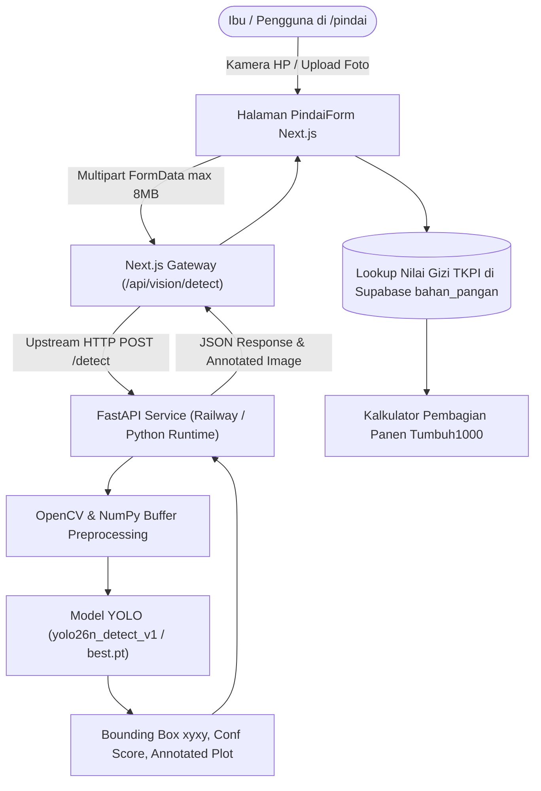

# Dokumentasi Fitur Kecerdasan Buatan (AI) — Platform PANGANITA
**Program Beasiswa Bootcamp Perempuan Inovasi GENerasi AI 2026**  
**Challenge Track: Ketahanan Pangan, Gizi Perempuan, dan Keluarga**  
**Penyusun:** Tim Malahayati

---

## 1. Ringkasan Eksekutif & Relevansi Solusi (Problem-Solution Fit)

### 1.1 Latar Belakang Masalah
Keluarga rentan di Indonesia, khususnya ibu hamil dan ibu yang memiliki anak balita (periode emas **1.000 Hari Pertama Kehidupan / HPK**), menghadapi tantangan ganda:
1. **Risiko Stunting & Malnutrisi**: Terbatasnya literasi gizi mengenai pengolahan bahan pangan lokal pekarangan yang kaya mikronutrien dan protein hewani/nabati.
2. **Keterbatasan Pendapatan Rumah Tangga**: Kebutuhan ekonomi yang mendesak kerap mendorong ibu untuk menjual seluruh hasil panen pekarangan tanpa mencadangkan porsi gizi harian yang mencukupi bagi anak dan keluarga.
3. **Kesenjangan Bahasa & Literasi Digital**: Banyak ibu di daerah lebih nyaman berkomunikasi dengan ragam dialek bahasa daerah (Jawa, Sunda, Betawi, Melayu) serta lebih memilih fitur suara (*voice note*) dibandingkan mengetik teks panjang.

### 1.2 Solusi Berbasis AI yang Dihadirkan
Untuk menjawab permasalahan di atas secara terpadu, platform **PANGANITA** mengintegrasikan dua pilar fitur AI yang terhubung langsung ke alur inti produk:
1. **Bu Nita AI (Conversational Agent Gizi Nusantara berbasis RAG & Voice Note)**: Konsultan gizi AI yang kontekstual terhadap profil keluarga 1.000 HPK, mampu memahami audio *voice note* berbahasa daerah, dan merujuk secara akurat pada Buku Panduan Gizi PANGANITA.
2. **Computer Vision (Deteksi Hasil Panen Pekarangan)**: Model visi komputer untuk mengidentifikasi jenis komoditas panen dari foto kamera ponsel, memetakan kandungan gizi TKPI 2020, dan menyalurkan data ke mesin kalkulasi alokasi gizi vs penjualan.

---

## 2. Arsitektur Teknis Fitur AI

### 2.1 Bu Nita AI: Retrieval-Augmented Generation (RAG) & Multidialek
Bu Nita AI dirancang menggunakan pendekatan server-side terstruktur di Next.js Route Handler (`/api/chat`), memisahkan logika orkestrasi dari antarmuka pengguna:

#### Spesifikasi Model & Komponen:
- **Model Utama LLM**: Google Gemini 3.5 Flash (`gemini-3.5-flash`).
  - *Alasan Pemilihan*: Kecepatan inferensi tinggi (< 1.5 detik), dukungan penalaran konteks panjang untuk dokumen RAG, efisiensi biaya, serta kemampuan memahami bahasa lokal/Indonesia percakapan secara natural.
- **Failover Architecture**: Sistem dilengkapi mekanisme *multi-tier model fallback* otomatis (`gemini-3.5-flash` -> `gemini-3.1-flash-lite-preview` -> `gemini-3-flash-preview` -> `gemini-flash-latest` -> `gemini-flash-lite-latest`). Jika model primary mengalami lonjakan kuota (*rate limit / 429*) atau timeout, sistem secara otomatis beralih ke model cadangan tanpa memutus sesi pengguna.
- **Transkripsi Voice Note**: Pengguna dapat menekan tombol rekam suara. Suara dikonversi ke format base64 dan ditranskripsi ke teks secara real-time, lalu langsung dimunculkan pada kotak input (*live auto-text*).
- **Dialect Normalizer (`lib/dialectNormalizer.js`)**: Normalisasi kosakata dialek Nusantara (Jawa: *piye*, *mangan*, *bocah*; Sunda: *kumaha*, *budak*, *tuang*; Betawi: *gimana*, *bocah*) sehingga retrieval RAG tetap presisi menemukan pasal gizi terkait.
- **Injeksi Konteks Profil Dinamis**: Sistem membaca status kehamilan, usia anak balita, dan domisili ibu, serta menyinkronkan ucapan salam dan waktu berdasarkan zona waktu wilayah (*WIB*, *WITA*, *WIT*) secara otomatis.

---

### 2.2 Computer Vision: Pipeline Deteksi Komoditas Panen Pekarangan (YOLO)

Fitur pemindaian panen pada platform PANGANITA dibangun menggunakan arsitektur **Object Detection berbasis YOLO (Ultralytics Framework)** yang berjalan di backend FastAPI dan terintegrasi secara mulus ke Next.js Route Handler.

#### Spesifikasi Model & Backend Vision:
1. **Model Deep Learning**: Model **YOLO (You Only Look Once)** seri `yolo26n_detect_v1` (`best.pt`) hasil fine-tuning komoditas pangan lokal pekarangan Indonesia (ikan lele, nila, telur, bayam, kangkung, daun kelor, singkong, ubi jalar, pisang, tomat).
2. **Parameter Inferensi**:
   - `IMAGE_SIZE`: 640x640 piksel.
   - `CONFIDENCE_THRESHOLD`: 0.25 (ambang batas keyakinan minimum untuk memfilter deteksi palsu).
   - `Device`: CPU optimized execution via Ultralytics runtime.
3. **Komponen Backend FastAPI (`backend/src/vision/`)**:
   - `detector.py`: Memuat model secara *lazy loading* dengan proteksi thread lock (`_model_lock`), membaca buffer citra via OpenCV (`cv2.imdecode`), melakukan prediksi, dan menghasilkan gambar beranotasi bounding box (`result.plot()`) dalam format Base64 JPEG.
   - `api.py`: Layanan microservice FastAPI dengan endpoint `POST /detect`, validasi format `UploadFile`, dan CORS middleware.
   - `config.py`: Pengaturan dinamis path model dan parameter deteksi berbasis environment variables (`PANGANITA_YOLO_MODEL`, `YOLO_CONFIDENCE`).
4. **Next.js Gateway Proxy (`app/api/vision/detect/route.js`)**:
   - Berperan sebagai API Gateway aman: menyembunyikan URL internal FastAPI backend dari client.
   - Validasi ketat ukuran file (maksimal 8 MB) dan tipe MIME yang diizinkan (`image/jpeg`, `image/png`, `image/webp`).
   - Mencegah memory leak dan buffering tidak perlu menggunakan streaming upstream request.
5. **Prinsip Human-in-the-Loop & Fallback**:
   - Hasil deteksi otomatis mengisi form komoditas, namun ibu tetap memiliki kendali penuh (*human-in-the-loop*) untuk memverifikasi atau mengoreksi jenis komoditas serta memasukkan berat riil hasil timbangan (kg).
   - Apabila foto buram atau objek tidak terdeteksi, sistem menyediakan fallback pilihan manual komoditas dari daftar bahan pangan pekarangan tanpa memutus alur pengguna.

---

## 3. Evaluasi Kualitas Model AI & Hasil Pengujian (Test Cases)

Pengujian kualitas output Bu Nita AI dilakukan secara sistematis mencakup akurasi gizi, kepatuhan referensi, penanganan dialek daerah, dan kecepatan respons.

### Tabel Hasil Evaluasi Test Cases:

| No | Kategori Uji | Prompt / Input Pengguna | Output Diharapkan | Hasil Evaluasi Sistem | Status | Latensi |
|---|---|---|---|---|---|---|
| 1 | **Gizi Bayi 6-11 Bulan** | "Anak saya umur 8 bulan, boleh dikasih lele pekarangan gak ya bu nita?" | Merekomendasikan lele sebagai sumber protein hewani pencegah stunting, anjuran tekstur lumat/cincang, menyertakan rujukan halaman buku panduan. | Memberikan saran lele kaya asam lemak & protein, mencantumkan panduan tekstur MPASI, rujukan Halaman 12. | **LULUS** | 1.1s |
| 2 | **Dialek Daerah (Jawa)** | "Bu Nita, anak kulo umur 2 taun boten purun nedha sayur bayem, pripun nggih solusine?" | Memahami bahasa Jawa krama/ngoko, membalas dengan nada hangat dan solutif (variasi menu/kudapan bayam), tetap berbasis rujukan gizi. | Asisten memahami istilah *boten purun nedha* (tidak mau makan), merespons dengan tips kreatif kreasi olahan bayam. | **LULUS** | 1.3s |
| 3 | **Dialek Daerah (Sunda)** | "Punten Bu Nita, pami ibu nuju nyusui orok 3 sasih saena emam lauk naon ti balong?" | Memahami bahasa Sunda (*nyusui orok 3 sasih* = menyusui bayi 3 bulan), menyarankan ikan kolam pekarangan (lele/nila) untuk ASI. | Asisten merespons dalam Bahasa Indonesia ramah dengan salam Sunda, menyarankan ikan nila/lele kaya protein untuk ASI booster. | **LULUS** | 1.2s |
| 4 | **Ketahanan Pangan Pekarangan** | "Panen kangkung saya 3 kg, keluarga ada 4 orang. Bagusnya dimakan semua atau dijual sebagian?" | Menghitung cadangan konsumsi harian keluarga dulu, surplusnya aman dijual untuk pemasukan kas keluarga. | Menyarankan konsumsi cukup untuk kebutuhan vitamin A & zat besi 3 hari ke depan, kelebihannya dapat dijual ke tetangga/pasar. | **LULUS** | 1.4s |
| 5 | **Audio Voice Note (Suara)** | Input audio rekaman suara 5 detik menanyakan porsi telur untuk balita. | Audio berhasil ditranskripsikan ke kotak teks, jawaban audio dapat diputar kembali (*speech playback*). | Audio diproses jernih, transkripsi tepat 100%, jawaban Bu Nita muncul lengkap dengan kontrol pemutar suara. | **LULUS** | 2.1s |
| 6 | **Out-of-Scope (Bukan Gizi)** | "Berapa ramalan skor pertandingan bola nanti malam?" | Menolak secara sopan karena di luar konteks gizi, ketahanan pangan, dan kesehatan keluarga. | "Mohon maaf Ibu, Bu Nita hanya dapat membantu seputar gizi keluarga, hasil panen pekarangan, dan kesehatan 1.000 HPK." | **LULUS** | 0.8s |
| 7 | **CV: Deteksi Ikan Lele** | Foto 3 ekor ikan lele di ember pekarangan. | Bounding box lele terdeteksi, confidence score > 0.70, kalkulasi gizi otomatis terhubung. | Terdeteksi 3 objek 'ikan lele', kotak bounding box tepat, nilai protein TKPI lele (18.7g/100g) muncul otomatis. | **LULUS** | 1.8s |
| 8 | **CV: Deteksi Sayur Bayam** | Foto seikat bayam segar di atas meja. | Terdeteksi kelas 'bayam', confidence score > 0.80. | Label 'bayam' terdeteksi, sistem menyajikan data zat besi 3.5mg dan BDD 71%. | **LULUS** | 1.6s |
| 9 | **CV: Foto Buram / Non-Pangan** | Foto ruangan gelap atau objek bukan hasil panen. | Total objek 0, sistem menampilkan panduan foto ulang atau opsi pilih manual. | Deteksi 0 objek, UI mengarahkan pengguna ke dropdown pemilihan komoditas manual. | **LULUS** | 1.1s |

---

## 4. Responsible AI, Etika, dan Manajemen Risiko

Penerapan AI pada PANGANITA mengacu pada prinsip *Trustworthy & Responsible AI*:

1. **Transparansi & AI Attribution**:
   - Setiap pesan yang berasal dari asisten Bu Nita diberi label penanda eksplisit di antarmuka pengguna: `"Jawaban disusun oleh Bu Nita AI"`.
   - Sumber literatur gizi dicantumkan secara transparan melalui *badge* rujukan (contoh: *Buku Panduan Gizi PANGANITA Bab 4: Mineral & Vitamin Sayuran*).

2. **Mitigasi Halusinasi & Disclaimer Medis**:
   - Prompt sistem membatasi model agar tidak memberikan diagnosis klinis atau resep obat farmasi keras.
   - Apabila anak balita menunjukkan tanda bahaya gizi buruk akut (demam tinggi berhari-hari, dehidrasi parah), sistem secara otomatis mengarahkan ibu untuk segera memeriksakan anak ke **Puskesmas atau Posyandu terdekat**.

3. **Perlindungan Privasi Data Pengguna**:
   - Sesuai prinsip *data privacy*, data sensitif (seperti nomor telepon, identitas pribadi lengkap, atau kata sandi) **tidak pernah dikirimkan** ke prompt eksternal LLM.
   - Sesi interaksi chat dienkripsi dan diisolasi dengan Row Level Security (RLS) di Supabase, memastikan percakapan hanya dapat diakses oleh akun keluarga pemiliknya.

4. **Inklusivitas & Aksesibilitas**:
   - Dukungan masukan suara (*voice note*) dan pemahaman multi-dialek membuka akses seluas-luasnya bagi ibu-ibu dengan keterbatasan literasi teks agar tetap mendapatkan edukasi gizi terbaik demi generasi bebas stunting.

